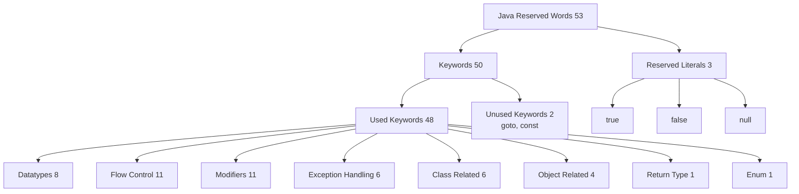

# Reserved Words in Java

1. Cat -> used to represent an animal
2. Apple -> used to represent a fruit
3. eat -> used to represent an action

In Java, we have exactly 53 reserved words to represent meaning or functionality.
Such words are called reserved words.

## Reserved Word Breakdown (Visual)

## Keywords (50)

### Reserved literals (3)
(words associated with some value)
- true
- false
- null

### Unused keywords (2)
- goto
- const

### Used keywords

#### Keywords for datatypes (8)
- byte
- short
- int
- long
- float
- double
- boolean
- char

#### Keywords for flow control (11)
- if
- else
- switch
- case
- default
- while
- do
- for
- break
- continue
- return

#### Keywords for modifiers (11)
- public
- private
- protected
- static
- final
- abstract
- synchronized
- native
- strictfp (1.2V)
- transient
- volatile

#### Keywords for exception handling (6)
- try
- catch
- finally
- throw
- throws
- assert (1.4V)

#### Class-related keywords (6)
- class
- interface
- extends
- implements
- package
- import

#### Object-related keywords (4)
- new
- instanceof
- super
- this

#### Return type keyword (1)
- void

In Java, a return type is mandatory.
If a method does not return anything, then we have to declare the method with `void` return type.

#### Enum keyword (1)
- enum

We can use enum to define a group of named constants.

## Conclusions

1. All 53 reserved words contain only alphabets.
2. All 53 reserved words contain only lowercase alphabets.
3. In Java, we have only the `new` keyword; there is no `delete` keyword.
4. Destruction of useless objects is taken care of by the garbage collector.
